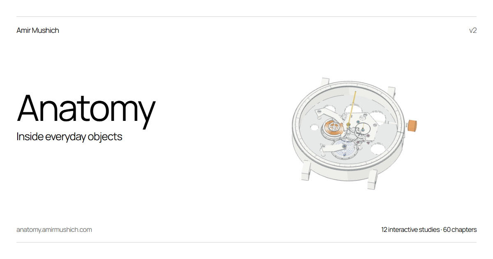

# Anatomy

Explore twelve everyday mechanisms as interactive 3D drawings by [Amir Mushich](https://amirmushich.com).

[Live gallery](https://anatomy.amirmushich.com/) · [Standalone download](https://github.com/amirmushichge/anatomy/releases/latest/download/anatomy.html)



White solids, thin outlines and five labelled functional colours make moving relationships visible. Each object has five short causal chapters, staged dissection and controls driven by its mechanism model.

## Objects

Click pen, mechanical keyboard, photo lens, mechanical watch, gamepad, cylinder lock, geared bicycle hub, four-stroke engine, DC motor, loudspeaker, bicycle pump and hard disk drive.

The lens exposes a threaded focusing carriage and a nine-leaf iris with a slotted drive ring. The watch links winding and individual beats to its gear train. Other experiments include a key's shear line, three hub ratios, motor polarity, check valves and HDD head parking.

## Use

Drag to orbit; wheel or pinch to zoom. Click or tap a part to pin its explanation. Focus frames the part; Return restores the previous camera, separation and chapter.

Learn opens the five chapters. Motion contains playback, held phases and the object's settings. Small screens split Playback and Settings to keep the scene on one screen. E separates every part; S slows time; B steps a phase or watch beat; W winds the watch. On the focused canvas, Space/Enter actuates and arrow keys orbit. Actual keyboard keys operate the keyboard; S/E remain tool shortcuts.

Reduced motion uses explicit held states. Without WebGL 2, static object previews remain available. Each HTML file embeds its runtime, models, font and previews and works offline.

## Build

Use Node 22 or later:

```sh
npm ci
npm run build
npm run audit
```

The build writes `dist/index.html`, twelve direct object HTML files, metadata, share cover and licence notices. It also writes standalone HTML files at the repository root. For browser checks:

```sh
npx playwright install chromium
npm run audit:browser
node review/check-build.mjs
```

To use an installed Chrome, set `CHROME_PATH` to its executable. Browser checks use Playwright; production needs no network or server API.

## Edit

- `study-core.mjs`, `study-ui.mjs`, `study-adapters.mjs`: shared materials, chapters, held phases and interactions.
- `study-catalog.mjs`, `presets/gallery-upgrades.mjs`: nine-object roles, chapters and geometry upgrades.
- `presets/*-model.mjs`, `presets/mechanisms.mjs`: mechanism poses and readouts.
- `presets/*-scene.mjs`, `presets/new-scenes.mjs`, `geometry.mjs`: solid geometry and part metadata.
- `viewer-engine.mjs`, `gallery-app.mjs`: rendering, cameras, picking and pinned inspection.

Edit generators, not generated preset JSON or bundled HTML. `presets/pen-baseline.json` and `qa/baseline-manifest.json` are retained reference inputs.

## Model limits

These are representative teaching models with prescribed kinematics, not measured commercial CAD or general contact/force solvers. Optics, electronics and acoustics have explicit simplifications. Inspection counts include integral and repeated features and are not manufacturing bills of materials. See [model inventory](PRESETS.md), [v2 changes and references](GALLERY-V2.md) and [scene contract](SCENE-STANDARD.md).

## Credits

Started from [Ryan's Anatomy skill](https://github.com/wheresryan22/anatomy), developed into this gallery by Amir Mushich. Three.js renders the scenes; the UI uses Manrope. MIT code and original notices are included; see [third-party credits](THIRD-PARTY.md). Linked reference documents retain their own rights.
