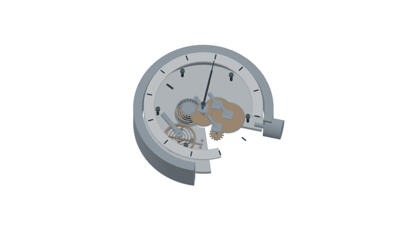

# Anatomy

An interactive collection of everyday mechanisms by [Amir Mushich](https://amirmushich.com).

Operate a cutaway object, pause its motion, select a part and look closer.
Twelve objects share the same viewer, controls and inspection system.

[Live gallery](https://anatomy.amirmushich.com) · [Download standalone HTML](https://github.com/amirmushichge/anatomy/releases/latest/download/anatomy.html)



## Objects

Click pen, mechanical keyboard, photo lens, mechanical watch, gamepad, cylinder
lock, geared bicycle hub, four-stroke engine, DC motor, loudspeaker, bicycle
pump and hard disk drive. There are 789 named solids/features. Integral ribs,
marks and illustrative tracks are inspection entities, not separate entries
in a manufacturing bill of materials.

## Use

Drag to orbit, wheel or pinch to zoom. Hover reveals a name; click/tap pins a
part in the inspector. Focus frames it and Return to object restores the prior
camera and separation. Inspect lists part groups, including hidden internals.

The primary button runs, pauses or resumes a cycle. Controls provides
mechanism parameters, playback speed and separation from 0 to 100%. S toggles
slow time, E separates/rejoins, Home fits and Escape closes inspection. On the
focused canvas, Space/Enter operates and arrow keys orbit. Physical keys also
operate the keyboard; S/E remain tool shortcuts.

Each object retains its state and camera when switching. Rendering stops at
rest. The UI fits a single screen, supports reduced motion, and provides
static previews when WebGL 2 is unavailable.

## Run and build

Node.js 22 or newer:

```sh
npm ci
npm run build
npm run audit
```

Open index.html directly for the offline gallery. dist/ is the static web
deployment, with an external social-preview image. The offline HTML contains
its runtime, models, font, previews and third-party notices.

```sh
npm run serve
```

The local server binds to 127.0.0.1:4173. No account or API key is needed.

## Add an object

1. Define named solids, descriptions and motion groups in a scene module.
2. Implement a pure pose/readout function in presets/mechanisms.mjs. Add the ID
   to NEW_IDS, a duration and an initial state.
3. Register the definition in presets/new-scenes.mjs and optional presentation
   metadata in scene-contract.mjs. Add an assets/<id>.png thumbnail.
4. Build and verify that geometry, motion and readouts agree.

viewer-engine.mjs handles the common renderer, camera, real-surface picking,
hover intent, focus visibility and resource disposal. gallery-app.mjs manages
per-object state and the inspector. geometry.mjs and presets/solid-kit.mjs
provide the solid builders. Generated preset JSON is a build result, except
presets/pen.json, which is the original pen definition.

This is a preset gallery. A scene authoring constructor is a later project.

## Model scope and verification

The objects use representative dimensions and educational kinematics. Force,
wear, optical rays, combustion, acoustics and electronics are not simulated.
See PRESETS.md for each mechanism's assumptions and references.

The automated audits cover 1,201 keyboard travel/contact states and 15,141
new-mechanism poses: finite solids, closed primitives, iris openings,
slider-crank joints, planetary ratios, pin alignment, watch ratios and pump
valves. Browser release checks cover all twelve objects, stable pinned
inspection, Focus/return, separation, pause/resume, touch pinch, reduced
motion, static fallback, offline loading and shared-context/resource reuse.

## License and credits

MIT for the project source. See LICENSE and THIRD-PARTY.md for retained notices.
Built with Codex, the Anatomy skill by Ryan, Three.js and Manrope. This is an
independent project; reference brands are not sponsors or clients.
